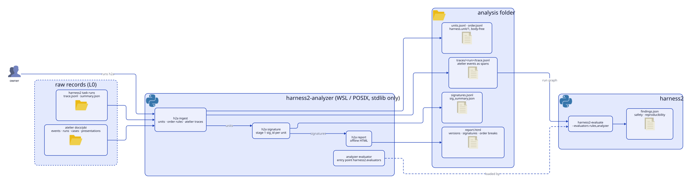

[English](README.md) | 日本語

# harness2-analyzer

[harness2](https://github.com/reeschan/harness2) のための評価の分析器 (1 段目)。エージェントのシステムの試行を、本文の無い 1 行 `harness.unit/1` にそろえ、決まった規則の失敗シグネチャを付け、版 (変更の前と後) をオフラインの HTML レポートで比べる。`harness2-evaluate` に評価者 `analyzer` も足す。

アダプタは 2 つ入っている。harness2 の trace (rollout 1 つ = 1 unit) と、atelier スキルの記録 (PBI の attempt 1 つ = 1 unit)。unit・シグネチャ・レポート・順番の規則の仕組みは、どちらのシステムにも依らない。システムごとの部分は [アダプタと規則](#アダプタと規則) に書いた。

設計は analyzer の設計書 draft-2 (2026-11-11) の §4 (`harness.unit/1`)・§5.1 (1 段目のシグネチャ)・§8 (`h2a ingest`・`h2a signature`・`h2a report`)・§9 (評価者)。2 段目 (ファセット・埋め込み・HDBSCAN)・`round`・replay・Hodoscope の書き出しは、まだ入れていない。held-out を使う判定もしない。

<picture>
  <source media="(prefers-color-scheme: dark)" srcset="assets/architecture/architecture-dark.svg">
  
</picture>

図のソースは `assets/architecture/architecture.d2`。arch-diagram スキルの `render.py` で描き直す。

## 要るもの

- POSIX (Linux か macOS)。Windows では WSL を使う (harness2 が `fcntl` を import するため)。
- Python 3.12〜3.13。
- `ingest`・`signature`・`report` は標準ライブラリだけで動く。評価者は harness2 を使う (インストールで reeschan/harness2 の `cfeafea` が入る)。

## インストール

```bash
uv venv -p 3.12 .venv
uv pip install -e .
```

## 使い方

```bash
h2a ingest --runs runs/lab --atelier ~/dev/my-repo --change-id pre-refactor --out analysis
h2a signature --dir analysis
h2a report --dir analysis
harness2-evaluate --runs analysis/traces --evaluators rules,analyzer
```

- `--runs DIR` (複数可): harness2 のタスクの run。`trace.jsonl` と隣の `summary.json` を読む。
- `--atelier DIR` (複数可): atelier のリポジトリか、その `docs/pbi`。`events.jsonl` (手元の `atelier.event/1` の行と、`harness.event/1` の外枠の両方)・`runs.jsonl`・`cases.jsonl` (case の id と大きさだけ) と、atelier が書くようになれば `presentations.jsonl` を読む。
- `--split FILE`: 分割の manifest (harness2 の `split_tasks.py` の出力か、atelier の manifest)。
- `--change-id ID`: change_id を持たない unit に付ける change_id (たとえばリファクタの前の run)。

| ファイル | 中身 |
|---|---|
| `units.jsonl` | `harness.unit/1`。1 行 = 1 試行 (harness2 の rollout か atelier の PBI の attempt) |
| `order.jsonl` | atelier のイベントの順番の破れ |
| `traces/<run>/trace.jsonl` | atelier のイベントを harness2 の trace にしたもの。所見の根拠をここに向ける |
| `signatures.jsonl`・`sig_summary.json` | unit ごとの 1 段目のシグネチャと、`sig_id` ごとの数 |
| `report.html` | 自己完結のレポート。版の比較・失敗のシグネチャ・根因・順番の破れ |

unit には整数・数・真偽・列挙・短い識別子しか入れない。自由文は `h:<12 桁>` にハッシュするか、弾く。レポートは版を `change_id`、無ければ `config_fp`・`harness_fp`・worker のプロンプトのハッシュの順で取って並べるので、変更の前後の run を比べられる。

## アダプタと規則

| 部分 | モジュール | 対象 |
|---|---|---|
| `harness.unit/1` と本文が無いことの点検 | `units.py`・`ids.py` | どのシステムでも |
| シグネチャの行と `sig_id` ごとの数 | `signature.py` | どのシステムでも |
| HTML レポート | `report.py` | どのシステムでも |
| 順番の規則の仕組み (`Before`・`NotAfter`) | `order.py` | どのイベントの列でも |
| harness2 のアダプタ (trace → unit) | `h2trace.py` | harness2 |
| atelier のアダプタ (events・runs・cases → unit) | `atelier.py` | atelier |
| atelier のイベントを harness2 の trace にする | `bridge.py` | atelier |
| 既定の順番の規則 (`DEFAULT_RULES`) | `order.py` | atelier のイベント |
| 評価者 `analyzer` | `evaluator.py` | harness2 (`harness2.evaluators`) |

ほかのシステムを足すには、`harness.unit/1` の行を返すアダプタ (順番の規則も使うなら、type・run id・時刻を持つイベントも)、`units.System` の値、`cli.py` の入力の引数が要る。アダプタを差し込む仕組みはまだ無い。3 つ目のシステムが来たときに作る。

## シグネチャ

- harness2 の rollout: `outcome`・`role`・`where`・`err` (正規化したエラー文のハッシュ)・`fell_back`・`attempts`・`switched`・`fenced`・`diff_types`。
- atelier の attempt: `pbi.attempted` に atelier が書いた `signature`。イベントの無い `runs.jsonl` の行には、`record_run.signature_of` と同じ規則で付ける。
- `sig_id` は、parts をキー順・詰めた JSON にした sha256 の先頭 12 桁 (atelier の `record_run.sig_id_of` と同じ規則)。

## 評価者 `analyzer`

entry point の `harness2.evaluators` に登録する。設定 (`--graph` の config) で `min_repeat` (既定 3)・`check_order`・`check_repeats` を渡せる。

- 順番 (`safety`・`reproducibility`): `harness2_analyzer/order.py` の規則。見せた記録の無い `question.answered` (入力に presentation があるときだけ確かめる)、`question.asked` の無い `question.answered`、`episode.started` の無い `episode.ended`・`episode.cost`、`run.started` の無い `run.ended`、`run.ended` の後の作業の記録。
- 失敗の繰り返し (`reproducibility`): `min_repeat` 個以上の unit が同じ失敗のシグネチャを持つとき。

## テスト

```bash
python -m unittest discover -s tests -t .
uvx ruff@0.17.1 check . && uvx ruff@0.17.1 format --check .
```

## ライセンス

Apache-2.0。
