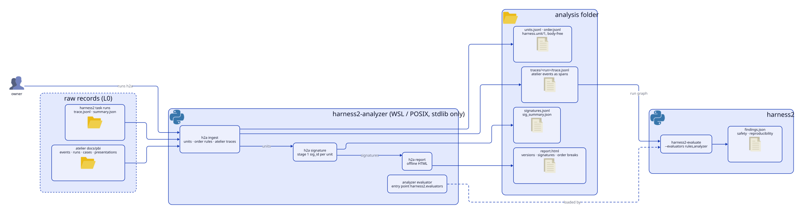

English | [日本語](README.ja.md)

# harness2-analyzer

An evaluation analyzer for [harness2](https://github.com/reeschan/harness2), stage 1. It brings
the trials of any agent system into one body-free row, `harness.unit/1`, gives each row a
deterministic failure signature, and compares versions (before and after a change) in an offline
HTML report. It also adds the `analyzer` evaluator to `harness2-evaluate`.

Two adapters are built in: harness2 traces (one unit per rollout) and the atelier skill's records
(one unit per PBI attempt). The unit, the signatures, the report and the order-rule engine do not
depend on either system; see [Adapters and rules](#adapters-and-rules) for what is specific to
each.

The design is the analyzer design draft-2 (2026-11-11): §4 (`harness.unit/1`), §5.1 (stage 1
signatures), §8 (`h2a ingest`, `h2a signature`, `h2a report`) and §9 (the evaluator). The second
stage (facets, embeddings, HDBSCAN), `round`, replay and the Hodoscope export are not part of
this package yet. Nothing here judges held-out splits.

<picture>
  <source media="(prefers-color-scheme: dark)" srcset="assets/architecture/architecture-dark.svg">
  
</picture>

The diagram source is `assets/architecture/architecture.d2`. Redraw it with the arch-diagram skill's `render.py`.

## Requirements

- POSIX: Linux or macOS. On Windows, use WSL (harness2 imports `fcntl`).
- Python 3.12 to 3.13.
- `ingest`, `signature` and `report` use only the standard library. The evaluator needs harness2,
  which the install brings in (pinned to reeschan/harness2 `cfeafea`).

## Install

```bash
uv venv -p 3.12 .venv
uv pip install -e .
```

## Use

```bash
h2a ingest --runs runs/lab --atelier ~/dev/my-repo --change-id pre-refactor --out analysis
h2a signature --dir analysis
h2a report --dir analysis
harness2-evaluate --runs analysis/traces --evaluators rules,analyzer
```

- `--runs DIR` (repeatable): harness2 task runs; every `trace.jsonl` with its `summary.json`.
- `--atelier DIR` (repeatable): an atelier repository or its `docs/pbi` folder. Reads
  `events.jsonl` (the local `atelier.event/1` rows and the `harness.event/1` envelope),
  `runs.jsonl`, `cases.jsonl` (only the case id and the size) and, once atelier writes it,
  `presentations.jsonl`.
- `--split FILE`: a split manifest (harness2 `split_tasks.py` output, or atelier's manifest).
- `--change-id ID`: the change id of units that record none, for example the run before a refactor.

| File | What it holds |
|---|---|
| `units.jsonl` | `harness.unit/1`, one trial per row: a harness2 rollout or an atelier PBI attempt |
| `order.jsonl` | the order breaks of the atelier events |
| `traces/<run>/trace.jsonl` | the atelier events as harness2 traces, so findings can point at them |
| `signatures.jsonl`, `sig_summary.json` | the stage 1 signature of each unit, and the counts per `sig_id` |
| `report.html` | the self-contained report: versions side by side, failing signatures, root causes, order breaks |

A unit holds only integers, numbers, booleans, enumerated values and short identifiers; free text
is hashed to `h:<12 hex>` or rejected. The report compares versions by `change_id`, else
`config_fp`, `harness_fp` or the worker prompt hash, so the runs before and after a change line up.

## Adapters and rules

| Part | Module | Scope |
|---|---|---|
| `harness.unit/1` and its body-free check | `units.py`, `ids.py` | any system |
| Signature rows and counts per `sig_id` | `signature.py` | any system |
| HTML report | `report.py` | any system |
| Order-rule engine (`Before`, `NotAfter`) | `order.py` | any event stream |
| harness2 adapter: traces to units | `h2trace.py` | harness2 |
| atelier adapter: events, runs and cases to units | `atelier.py` | atelier |
| atelier events as harness2 traces | `bridge.py` | atelier |
| Default order rules (`DEFAULT_RULES`) | `order.py` | atelier events |
| `analyzer` evaluator | `evaluator.py` | harness2 (`harness2.evaluators`) |

Another system needs its own adapter that returns `harness.unit/1` rows (and, for order rules,
events with a type, a run id and a time), a value in `units.System`, and an input flag in `cli.py`.
There is no plug-in point for adapters yet; one will be added when a third system arrives.

## Signatures

- harness2 rollout: `outcome`, `role`, `where`, `err` (hash of the normalized error),
  `fell_back`, `attempts`, `switched`, `fenced`, `diff_types`.
- atelier attempt: the `signature` atelier writes on `pbi.attempted`; a `runs.jsonl` row without
  an event gets the one `record_run.signature_of` would give.
- `sig_id` is the first 12 hex digits of the sha256 of the parts as sorted, compact JSON, the same
  rule as atelier's `record_run.sig_id_of`.

## The `analyzer` evaluator

Registered under the entry point group `harness2.evaluators`. Options (through a `--graph`
config): `min_repeat` (default 3), `check_order`, `check_repeats`.

- Order (`safety`, `reproducibility`): the rules in `harness2_analyzer/order.py`. A
  `question.answered` with no presentation before it (checked only when the input holds
  presentations), with no `question.asked`, an `episode.ended` or `episode.cost` with no
  `episode.started`, a `run.ended` with no `run.started`, and work recorded after `run.ended`.
- Repeated failures (`reproducibility`): a failing signature shared by `min_repeat` units.

## Test

```bash
python -m unittest discover -s tests -t .
uvx ruff@0.17.1 check . && uvx ruff@0.17.1 format --check .
```

## License

Apache-2.0.
